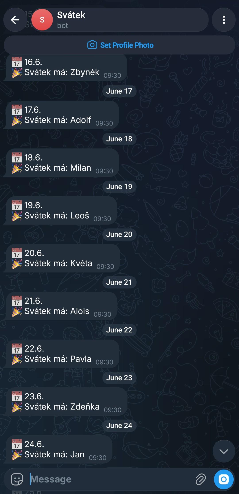

# Telegram_bot-svatek

A Telegram bot for daily name day (svátky) notifications with automatic scheduling.

👉 **Try the bot:** [https://t.me/svatek_bot](https://t.me/svatek_bot)

> **Note:** The code in this repository is almost unnecessary if you just want daily name day notifications—anyone can simply start and use my bot directly. The source code is here for transparency, self-hosting, or customization.

---

## Preview

This is what the message looks like when the bot sends it to your Telegram channel or chat every morning:



---

## Setup & Installation

### 1. Prerequisites
To keep your sensitive data (tokens) safe from being exposed on GitHub, this script uses system environment variables. You will need:
-   **A Telegram Bot Token** (obtained from [@BotFather](https://t.me/BotFather))
-   **A Chat ID** (the ID of the chat or channel where the bot should send messages)

### 2. Automatic Scheduling (Cron)

To make the bot send messages automatically every day, add it to your Linux system scheduler (`cron`).

1. Open the cron configuration for your current user:
   ```bash
   crontab -e
